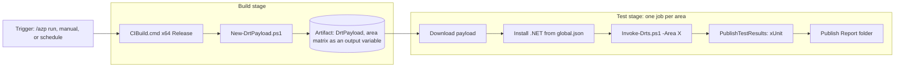

# Implementing DRTs on CI

## Status

Draft plan. M0 is done. M1 is implemented (`eng/pipelines/drts.yml`, `eng/pipelines/templates/drt-stages.yml`, `eng/scripts/New-DrtPayload.ps1`, `eng/scripts/Invoke-Drts.ps1`) and is waiting for an ADO pipeline definition (D3). For the background, required capabilities (C1–C4) and decisions, see [Running DRTs on CI](running-drts-on-ci.md).

## Scope

Phase 1 covers DRTs only, in wpf-test, on Azure DevOps build agents.

- **Configurations:** x64 Release first. x86 comes later.
- **WPF under test:** the .NET SDK pinned in `global.json`.
- **Out of scope for now:**
  - Feature tests.
  - Running in dotnet/wpf (phase 2).
  - The internal mirror (phase 3).
  - Helix.

The pipeline logic goes into a template so that dotnet/wpf can reuse it in phase 2.

## Files

| File | Purpose |
|---|---|
| `eng/pipelines/drts.yml` | Pipeline entry point. Defines the triggers and runtime parameters, then calls the template. |
| `eng/pipelines/templates/drt-stages.yml` | Reusable build and test stages. Parameters: the artifact source, platform, configuration, filters, and whether to rerun failures. |
| `eng/scripts/New-DrtPayload.ps1` | Collects the minimal DRT payload from `publish\<config>\<platform>\Test`. Also writes the matrix of areas. |
| `eng/scripts/Invoke-Drts.ps1` | Runs QV on the agent. Prepares the machine, runs, and sets the exit code. Used locally as well. |

The existing `azure-pipelines.yml` and `eng/pipeline.yml` stay unchanged. Running DRTs on every PR would slow every PR down, so the DRT pipeline is a separate pipeline definition in ADO.

## Pipeline



### Triggers and parameters (C1, C2)

```yaml
trigger: none
pr: none          # to be verified: does `/azp run` need a pr: trigger? (I15)
schedules:
- cron: "0 2 * * *"
  branches: { include: [ main ] }
  always: false

parameters:
- name: areas       # empty means every area in DrtList.xml
  type: string
  default: ' '
- name: name        # forwarded to /Name=
  type: string
  default: ' '
- name: keywords    # forwarded to /Keywords=
  type: string
  default: ' '
- name: priority    # forwarded to /Priority=
  type: string
  default: ' '
- name: rerunFailures
  type: boolean
  default: true
```

- **PR comments:** `/azp run <drt-pipeline-name>` runs every DRT with the default parameters.
- **Filtered runs:** use the ADO **Run pipeline** dialog. Filtering from a PR comment would need a bot and is deferred.

### Stage 1: Build

One job on the same pool and image as `eng/pipeline.yml` (`NetCore-Public`, `windows.vs2026preview.scout.amd64.Open`).

1. `checkout: self`.
2. `eng\scripts\CIBuild.cmd -configuration Release -prepareMachine /p:Platform=x64`.
3. `New-DrtPayload.ps1 -Configuration Release -Platform x64 -Areas '${{ parameters.areas }}'`.
   - Copies `DRT\`, `Infra\` and `Common\`, the `*.cmd` scripts, `DiscoveryInfoDrts.xml`, `xsltTranform\`, and `Invoke-Drts.ps1` into `artifacts\DrtPayload`. That is about 95 MB, compared with 1.8 GB for the full `Test` folder.
   - Reads `DRT\DrtList.xml` and builds the area matrix. If areas are given, it keeps only those areas.
   - Writes the matrix as an output variable: `##vso[task.setvariable variable=matrix;isOutput=true]{"Annotations":{"area":"Annotations"},...}`.
4. `PublishPipelineArtifact`: `DrtPayload_x64_Release`.

Building the matrix from `DrtList.xml` means that new or renamed areas need no YAML change.

### Stage 2: Test (C3, C4)

```yaml
- stage: Test
  dependsOn: Build
  jobs:
  - job: Drt
    strategy:
      matrix: $[ stageDependencies.Build.Build.outputs['areas.matrix'] ]
      maxParallel: 8          # to be tuned against agent availability
    timeoutInMinutes: 60
    workspace: { clean: all }
```

Steps:

1. `checkout: self` with `fetchDepth: 1`. This is only needed for `global.json` and `eng/common`.
2. Download `DrtPayload_x64_Release` to `$(Pipeline.Workspace)\drt`.
3. Install the .NET SDK from `global.json` with `eng/common/tools.ps1` (`InitializeDotNetCli -install`). Then set `DOTNET_ROOT`, and `DOTNET_MULTILEVEL_LOOKUP=0` so that the DRTs use this runtime and not one installed on the machine.
   - **Decision:** install the SDK in every job. The DRTs are framework-dependent, so each machine needs the exact runtime. Shipping only the runtime in the payload would be smaller, but installing the SDK keeps the payload simple and matches how the build gets .NET. Revisit this if the install time per job becomes a problem.
4. `Invoke-Drts.ps1 -Area $(area) [filters] [-RerunFailures]`.
   - Before the run: delete the run directory and stop any leftover test processes.
   - Run QV with `/RunDirectory=$(Agent.TempDirectory)\QV\Run`, a known path rather than `%APPDATA%`.
   - Exit with a non-zero code if `Report\DrtReport.xml` is missing or the pass rate is below 100%. This applies until QV change Q2 is made.
5. `PublishTestResults@2` with `condition: always()`:
   - `testResultsFormat: XUnit`.
   - `testResultsFiles: $(Agent.TempDirectory)\QV\Run\Report\testResults.xml`.
   - `testRunTitle: DRT $(area) x64 Release (attempt $(System.JobAttempt))`.
   - `failTaskOnFailedTests: true`.
   - `failTaskOnMissingResultsFile: true`.
6. `PublishPipelineArtifact` with `condition: always()`:
   - Contents: the `Report` folder and any `*.dmp` files.
   - Name: `DrtReport_$(area)_$(System.JobAttempt)`. A rerun needs a unique artifact name, so the attempt number is part of the name.

How the capabilities map:

- **C3, retries:** QV's `/RerunFailures` retries a failing DRT once. `retryCountOnTaskFailure` is **not** used at first, because it would hide failing runs.
- **C4, rerunning failed areas:** a failed area fails its own job, so **Rerun failed jobs** reruns only those areas and reuses the same payload. To rerun one test, run the pipeline manually with `name=` set.
- **No `continueOnError`.**

## QualityVault changes

Each change below makes QV easier to drive from a pipeline. They are listed in order of priority. None of them blocks a first working pipeline, because `Invoke-Drts.ps1` can work around all of them.

| # | Change | Why | Where |
|---|---|---|---|
| Q1 | Keep `QualityVaultFrontend`'s exit code in `QV.cmd` (`set rc=%errorlevel%` … `exit /b %rc%`). | `QV.cmd` ends with `rd`, so the frontend's `-1` for an infrastructure failure is lost and the step looks successful. | `src\Test\BranchCommon\data\QV.cmd` |
| Q2 | Return a distinct exit code when tests fail: for example `0` for all passed, `1` for test failures, `-1` for an infrastructure error. Behind a switch such as `/FailOnTestFailure` so local behavior doesn't change. | Today `Main` returns 0 whenever the run finishes, so scripts check the pass rate in `DrtReport.xml` with `findstr`. | `QualityVaultFrontend\MainEntry.cs`, `RunCommand.cs` |
| Q3 | Better xUnit report: name each `<assembly>` after its area; set `type` to the area and `method` to the test name; add `<trait>`s for Area, SubArea, Owner and Priority; put a short failure reason in `<message>` and the DRT's output in `<output>`. | Today each assembly is named after the first test's executable, and every DRT has `type="Microsoft.Test.Drt.DrtRunner"` and `method="Main"`. The failure message holds only the repro arguments, so the DRT's output is not visible in the Tests tab (seen in M0). | `QualityVaultUtilities\Reporting\XUnitReportGenerator.cs` |
| Q4 | Record a pass on rerun: keep the first attempt's failure, and report the test as passed with a `Flaky=true` trait and a note in `<output>`. | `ClearResult` drops the first failure, so flaky tests are invisible. The xUnit format has no "flaky" outcome, so a trait is the best available option. | `ExecutionEngine.cs` (rerun around L335 and L386), `XUnitReportGenerator.cs` |
| Q5 | `/RerunCount=N` instead of a single fixed rerun. | Makes it possible to tune retries. | `RunCommand.cs`, `ExecutionEngine.cs` (`ShouldRerun`) |
| Q6 | Let QV run without copying `Infra` into `%ProgramFiles%`, for example with an environment variable or switch that runs it in place. | Copying needs administrator rights and shares one machine-wide location between runs. | `QV.cmd` |
| Q7 | Remove the unused Helix result-upload code (`HELIX_RESULTS_CONTAINER_*`). | Cleanup. | `XUnitReportGenerator.cs` |

`RunDrts.cmd` and `CIRunDrts.cmd` stay as they are for local use. The pipeline uses `Invoke-Drts.ps1`, which calls `QV.cmd` directly.

## Milestones

| # | Milestone | Done when |
|---|---|---|
| M0 | ✅ **Probe the agent.** Done; see [M0 results](#m0-results). A temporary PR pipeline step runs `RunDrts.cmd /Area=Controls` and logs elevation, session, resolution and the `%APPDATA%` path. A small matrix of 4 jobs also logs the machine name, OS install time, boot time and agent uptime, and writes then checks for a marker file under `%ProgramData%`. | We know whether DRTs can run on `windows.vs2026preview.scout.amd64.Open` as they are, and whether each job gets a freshly imaged machine or agents are reused across jobs (I20). |
| M1 | `drts.yml` with a single test job that runs every DRT, publishes results and the report. | A manual run shows the DRT results in the Tests tab. |
| M2 | A matrix with one job per area, built from `DrtList.xml`, plus filter parameters. | **Rerun failed jobs** reruns only failed areas. |
| M3 | QV changes Q1–Q3. | Exit codes are reliable and the Tests tab is readable. |
| M4 | `/azp run` comment trigger and the nightly schedule. | A wpf-test PR comment starts a DRT run. |
| M5 | QV changes Q4 and Q5. | Flaky tests are visible. |
| M6 | Phase 2: dotnet/wpf uses the template with locally built WPF. | A dotnet/wpf PR can start a DRT run. |

## M0 results

Probe PR [#357](https://github.com/dotnet/wpf-test/pull/357), [build 1642578](https://dev.azure.com/dnceng-public/cbb18261-c48f-4abb-8651-8cdcb5474649/_build/results?buildId=1642578), on 2026-10-20. Pool `NetCore-Public`, image `windows.vs2026preview.scout.amd64.Open`.

| Question | Result |
|---|---|
| Operating system | Windows Server 2025 Datacenter (10.0.26100). |
| Elevation | `cloudtest`, a local administrator at High integrity. QV's copy into `%ProgramFiles%\QualityVault` works. |
| Desktop session | Interactive `console` session 1, `UserInteractive=True`, with `explorer.exe` running. **Server Manager opens on the desktop at logon,** with a pop-up in front of it. |
| Screen | 1024×768, 32 bpp. |
| Global .NET | 6.0, 8.0 and 10.0 only. The DRTs ran on the repo's `.dotnet` (11.0 RC) through `DOTNET_ROOT`, which confirms that .NET must be installed in each job. |
| `%APPDATA%` | `C:\Users\cloudtest\AppData\Roaming`. |
| Agent reuse | None. All five jobs ran on different machines whose OS had been installed 10–20 minutes earlier, and none found another job's marker file. |
| DRTs | `RunDrts.cmd /Area=Controls` ran `DrtControls.exe`. About 50 suites ran, then it **hung in the ToolTip suite** until QV's 240-second timeout killed it, so the result was Fail. |
| ADO integration | Works. `RunDrts.cmd` exited with 1; `PublishTestResults@2` published `testResults.xml` to the Tests tab and failed the task (`failTaskOnFailedTests`). The QV `Report` folder was uploaded as an artifact. |

Follow-ups:

- **Close Server Manager before running DRTs.** Re-probe in [build 1642720](https://dev.azure.com/dnceng-public/cbb18261-c48f-4abb-8651-8cdcb5474649/_build/results?buildId=1642720): after `Stop-Process ServerManager` the desktop was clear, the ToolTip suite passed alone, and all of `DrtControls` passed (Pass, in about 1.5 minutes). One run doesn't prove Server Manager caused the hang, but closing it is cheap, so `Invoke-Drts.ps1` will do it.
- Locally, `DrtControls -suite ToolTip` passes. Full local runs over RDP fail in Menu suites because of keyboard layout (AltGr) and mouse focus, so local results don't reflect the agent (I21).
- **Baseline for all DRTs** ([build 1642763](https://dev.azure.com/dnceng-public/cbb18261-c48f-4abb-8651-8cdcb5474649/_build/results?buildId=1642763), Release x64, Server Manager closed): **79 of 85 pass**, and the run took about 17 minutes in one job. Failures (input for D5):

  | DRT | Area | Failure |
  |---|---|---|
  | `DrtControls` | Controls | Hung in the ToolTip suite until QV's 240-second timeout. It passed in the previous run, so it is intermittent. |
  | `DrtApplicationEvents` | AppModel | Hung until QV's 240-second timeout. |
  | `DrtJournal` | AppModel | Failed in "Basic Journal Navigation". The log was truncated by QV. |
  | `DrtPackagingApis` | DigitalDocuments | Failed in the zip archive tests. Needs `/verbose` to see why. |
  | `Drtparser` | Xaml | "DateTime Test": `DateTime` serialization differs from the expected string. |
  | `DrtPrinting` | Printing | "Print Queue": PostScript output hash differs from the expected value. |
- **Quarantine (D5, decided):** these six are marked `Disabled="true"` in `DrtList.xml`, with a comment giving the reason. `DrtAdaptor` maps the attribute to `TestInfo.Disabled`, which QV already skips by default; run them with `RunDrts.cmd /Disabled=true`. In [build 1642817](https://dev.azure.com/dnceng-public/cbb18261-c48f-4abb-8651-8cdcb5474649/_build/results?buildId=1642817) the result was 79 passed and 6 ignored. Issues and owners for the six: done.
- Merging the latest `main`, which uses SDK 12.0 alpha, broke the restore for `net11.0-windows`. As a temporary workaround, this branch keeps the 11.0 RC SDK in `global.json` while taking `main`'s Arcade version. PR #355 needs the same fix.

## Decisions

- **D5, quarantine:** decided; see [M0 results](#m0-results).
- **D7, triggers:** `/azp run <pipeline name>` from a PR comment, plus manual runs. No PR or CI trigger. A nightly schedule can come later (M4). Whether `/azp run` works with `pr: none` is still to be verified (I15).
- **D3, the ADO pipeline definition:** open. `eng/pipelines/drts.yml` does nothing until a pipeline definition in the `dnceng-public/public` ADO project points at it. That definition is what gives the pipeline a name for `/azp run <name>`, connects it to the GitHub repo through the service connection, and lets people start it from the **Run pipeline** dialog. Creating one needs pipeline-creation rights in `dnceng-public`, which the WPF team may not have; the usual route is a request to dnceng. Until then, M1 can only be validated by running the template from a temporary PR, as M0 was.

## Open questions

- **I15:** Does `/azp run` work for a pipeline with `pr: none`? Which GitHub permissions does a user need to trigger it?
- **I16:** Answered in M0: 1024×768. Whether some DRTs need more is still open; MAUI sets 1920×1080 before its UI tests.
- **I21:** Does `DrtControls` pass locally? On the agent it hangs in the ToolTip suite. Is that caused by the agent (Server Manager in the foreground, 1024×768), or does it fail everywhere?
- **I17:** Is there a sensible `maxParallel` and job size? There are 21 areas; small ones could be grouped.
- **I20:** Answered in M0: every job gets a freshly imaged VM, so cleanup between jobs is not needed. Cleanup within a job, for example between areas grouped into one job, still is.
- **I18:** Do the DRTs leave machine-wide state (registry, `%ProgramFiles%\QualityVault`, fonts, themes) that matters on reused agents?
